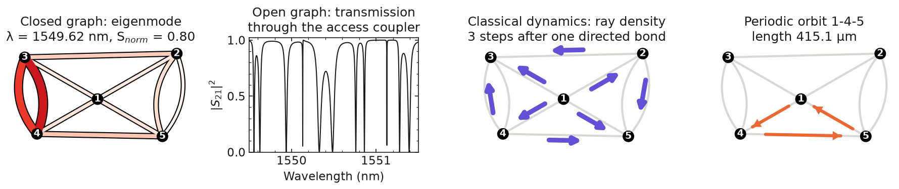
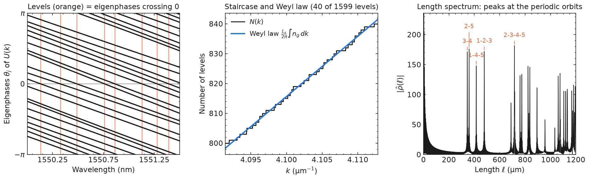
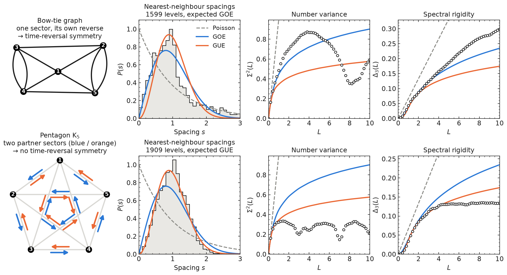
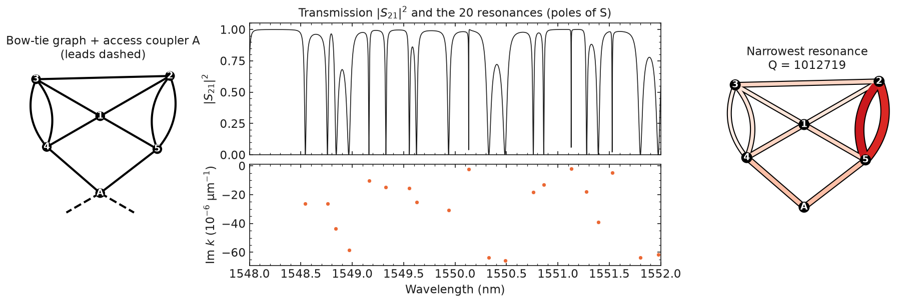
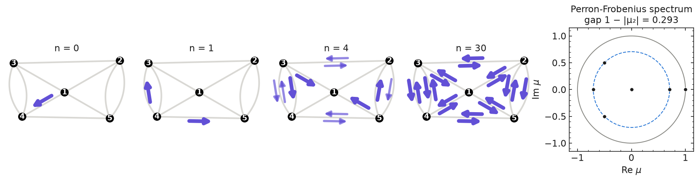
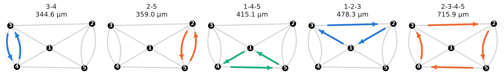

# quantum-graphs

[](https://github.com/gogofeefee/quantum-graphs/actions/workflows/tests.yml)
[](pyproject.toml)
[](LICENSE)
[](https://doi.org/10.5281/zenodo.23812663)

Python tools to simulate **quantum graphs** — networks of one-dimensional
waveguides joined at vertices — in the vertex scattering-matrix formalism of
Kottos and Smilansky. The package was written to model integrated photonic
circuits made of silicon waveguides and directional couplers, but every
module accepts arbitrary vertex scattering matrices.



*The bow-tie graph of a fabricated silicon device seen by the four
subpackages: an eigenmode of the closed graph, the transmission of the graph
opened by an access coupler, the classical density of rays three steps after
leaving one bond, and one of its periodic orbits. All figures of this page
are produced by [`docs/make_figures.py`](docs/make_figures.py).*

| Subpackage | What it computes |
|------------|------------------|
| [`closed_graphs`](#closed-graphs-spectrum-and-eigenmodes) | Spectrum and eigenmodes of a closed graph, Weyl law, spectral statistics (NNSD, Σ², Δ₃), length spectrum |
| [`open_graphs`](#open-graphs-scattering-matrix-and-resonances) | Scattering matrix S(k) of a graph with leads, complex resonances, transmission spectra, resonance statistics |
| [`classical_graphs`](#classical-dynamics) | Ray dynamics: Perron-Frobenius operator, ergodicity, mixing, animated probability flow |
| [`periodic_orbits`](#periodic-orbits) | Periodic orbits of a directional-coupler graph, with physical and optical lengths |

plus `stats` (unfolding, NNSD, Σ², Δ₃ and random-matrix reference curves),
`layouts` (ready-made geometries) and `dispersion` (tabulated n_eff(k),
n_g(k)). The complete list of classes, methods and functions is in
[docs/api.md](docs/api.md).

---

**Contents** —
[Installation](#installation) ·
[Quick start](#quick-start) ·
[Describing a graph](#describing-a-graph) ·
[Gallery](#gallery) ·
[Examples](#examples) ·
[How it works](#how-it-works) ·
[Documentation](#documentation) ·
[Tests](#tests) ·
[Citing](#citing)

---

## Installation

Python ≥ 3.10, with numpy, scipy, matplotlib and numdifftools.

```bash
git clone https://github.com/gogofeefee/quantum-graphs.git
cd quantum-graphs
pip install -e .                 # or: pip install -e ".[test]" to run the tests
```

[ffmpeg](https://ffmpeg.org) is only needed to save the classical animations
as `.mp4` (use `writer="gif"` otherwise).

## Quick start

```python
import quantum_graphs as qg

graph = qg.ClosedDirectionalGraphs(
    **qg.layouts.bow_tie_graph(),      # vertex_positions and bonds (lengths in µm)
    couplings=0.5,                     # power cross-coupling C of every coupler
    neff=3.97,                         # effective index: a float or a function neff(k)
    wavelength_range=(1.50, 1.60),     # vacuum wavelengths (µm)
    name="BowTie",
)
spectrum, degeneracies = graph.compute_spectrum()   # 529 levels, about one second
print(graph.sectors)                   # one sector, its own reverse: GOE expected

graph.plot_graph(show_lengths=True)
graph.short_range_correlations()       # nearest-neighbour spacings vs Poisson / GOE
graph.long_range_correlations()        # number variance Σ²(L), spectral rigidity Δ₃(L)
```

Figures are shown and returned; `save_fig=True` writes them to
`<script folder>/<name>/<parameters>/`, next to the cached computations
(spectra, resonances) and a `graph_parameters.txt` summary; building a graph
writes nothing. To start a study on your own graph, copy
[`examples/new_study_template.py`](examples/new_study_template.py).

For batch runs:

```python
qg.set_options(show=False, verbose=False)      # or: with qg.options(show=False): ...
```

or the environment variables `QUANTUM_GRAPHS_SHOW=0`,
`QUANTUM_GRAPHS_VERBOSE=0`. Scans run in `n_workers` threads (default: half
the cores, at most 8; `QUANTUM_GRAPHS_WORKERS`); results do not depend on it.

## Describing a graph

All lengths are in µm and all wavelengths are vacuum wavelengths in µm. A
graph is a list of bonds between the **ports** of its vertices (the ports of
a vertex are numbered 0 … valency − 1):

```python
vertex_positions = [(x0, y0), (x1, y1), ...]   # µm, for drawing (and default lengths)
bonds = [(i, p, j, q, L), ...]   # port p of vertex i <-> port q of vertex j, length L (µm);
                                 # (i, p, j, q) without L: Euclidean distance
leads = [(v, p), ...]            # open graphs only: external leads, in S-matrix order
```

For example, two couplers joined by two bonds, a self-loop, and two leads on
vertex 0:

```python
graph = qg.OpenDirectionalGraphs(
    vertex_positions=[(0, 0), (100, 0)],
    bonds=[(0, 1, 1, 0, 120.0), (0, 3, 1, 2, 180.0),   # two bonds between 0 and 1
           (1, 1, 1, 3, 400.0)],                       # a self-loop on vertex 1
    leads=[(0, 0), (0, 2)],
    couplings=0.5, access_couplings=0.3, neff=2.4,
    wavelength_range=(1.50, 1.60))
```

* **Validation.** A port used twice or left unconnected, a non-positive
  length, or a vertex matrix whose size differs from the vertex valency raise
  a `ValueError`.
* **Self-loops and multiple bonds are ordinary bonds.** Figures draw parallel
  bonds as symmetric arcs (`bond_spacing` sets their distance) and self-loops
  as teardrops of their true length; this geometry is for drawing only.
* **`graph.topology`** holds the validated graph as read-only arrays
  (`bonds`, `leads`, `length`, `valency`, `positions`) and the **directed
  bonds**: bond `b = (i, p, j, q)` gives `d = b` from (i, p) to (j, q) and
  `d = b + B` back, with `src_vertex`, `src_port`, `dst_vertex`, `dst_port`,
  `directed_length` and the lookups `reverse(d)`, `bond_of(d)`,
  `is_forward(d)`, `leaving(v, p)`, `arriving(v, p)`, `directed(i, p, j, q)`.
  `graph.n_vertices`, `n_bonds`, `n_leads` and `total_length` are shortcuts.
* **Index.** `neff` is a constant or a function `neff(k)`; the group index
  `ng` is derived from it when not given ([`dispersion`](docs/api.md#dispersion)
  loads tabulated MPB data).
* **Vertex labels** on the figures start at 1 (vertices numbered 1, 2, … in
  index order), except the vertices carrying leads (access couplers),
  labelled `A` (`A1`, `A2`, … if there are several).

### Vertex matrices

`DirectionalGraphs` / `DirectionalClassicalGraphs` model every vertex as a
lossless 4-port directional coupler with power cross-coupling C (a float, a
list or dict per vertex, or a function `C(k)`); ports (0, 1) are one arm,
(2, 3) the other:

```
σ = [[ 0,      0,      √(1−C), i√C    ],
     [ 0,      0,      i√C,    √(1−C) ],
     [ √(1−C), i√C,    0,      0      ],
     [ i√C,    √(1−C), 0,      0      ]]
```

In open graphs, `access_couplings` (default: `couplings`) sets the couplers
that carry leads. For any other junction, use the base classes
(`ClosedGraphs`, `OpenGraphs`, `ClassicalGraphs`) with `vertex_matrices` (one
array per vertex, one array for all, or a function σ(k); `access_matrices`
for the vertices with leads): `qg.neumann_matrix(n)` gives the
Neumann-Kirchhoff matrix, `qg.PASS_THROUGH` a 2-port transmission.

---

## Gallery

Each figure below is made from the public API; the code that produced it is
in [`docs/make_figures.py`](docs/make_figures.py), and the snippets show the
corresponding calls.

### Closed graphs: spectrum and eigenmodes



The levels of a closed graph are the wavenumbers k at which an eigenphase of
the unitary bond map U(k) crosses 0 (left). `compute_spectrum` counts these
crossings exactly in every interval, so that no level is missed and close
levels are not merged. Their number follows the Weyl law (centre), and the
Fourier transform of the spectrum peaks at the lengths of the periodic orbits
(right).

```python
spectrum, degeneracies = graph.compute_spectrum()
modes = graph.compute_wavefunction(spectrum[10])   # basis of ker(I − U(k)), one row per mode
graph.plot_wavefunction(modes, spectrum[10])        # intensity on every bond
graph.plot_staircase_function(weyl_diff=True)       # N(k) and N(k) − N_Weyl(k)
graph.plot_length_spectrum(L_max=1500)
graph.plot_entropy(); graph.plot_ipr()              # localisation of every mode
```

### Spectral statistics and symmetry sectors



Through the nonzero entries of the vertex matrices, a wave on a directed
bond only reaches some of the directed bonds: `graph.sectors` splits U(k)
into independent blocks. With reciprocal couplers the reversed bonds of a
sector are either the sector itself (time-reversal symmetry, GOE expected —
bow-tie graph, top) or a **partner sector** with the same spectrum: every
level is then doubly degenerate and each sector has no time-reversal symmetry
left (GUE expected — complete pentagon K₅, bottom, although each coupler
matrix is symmetric). Statistics use one sector of each pair, unfolded with
its own Weyl law. Beyond L of the order of L_s/ℓ_min (ℓ_min the shortest
periodic orbit), Σ² leaves the random-matrix curve and oscillates with the
shortest orbits (Berry's non-universal regime).

```python
graph.sectors                    # Sectors(Sector(0: 20 directed bonds, L_s = 3194.142 µm, self-reverse, GOE))
graph.spectral_ensemble()        # 'GOE'
x = graph.unfolded_spectrum()    # unit mean spacing
L, s2 = graph.sigma2(L_max=10)
L, d3 = graph.delta3(L_max=10)
graph.short_range_correlations(spectrum=measured_k)   # the same analysis of measured levels
```

### Open graphs: scattering matrix and resonances



Leads attached to some ports turn the graph into a scatterer. `S(k)` gives
the scattering matrix at real or complex k; the resonances are its poles in
the complex k-plane, found by Newton's method and certified complete by the
argument principle (`count_resonances`). A real measurement only gives the
transmission: `find_experimental_resonances` detects its peaks as one would on
a measured spectrum.

```python
opened = qg.OpenDirectionalGraphs(**qg.layouts.bow_tie_graph(open=True),
                                  couplings=0.5, access_couplings=0.3, neff=3.97,
                                  wavelength_range=(1.545, 1.555))
S = opened.S(k)                                     # (n_leads, n_leads), or (m, ...) for m values of k
resonances, multiplicities = opened.find_resonances(im_min=-1e-4)
opened.plot_S_amplitude(1.545, 1.555, 20_000, (1, 0), spectrum=resonances)
opened.plot_resonance_wavefunction(index=0)
opened.plot_energy_distribution(k, injection_port=0)   # field for light injected in lead 0
```

### Classical dynamics



Rays follow the bonds and split at the vertices with the probabilities
|σ|²: the Perron-Frobenius operator P = |Σ|² (element-wise) evolves a
probability vector on the directed bonds. On the bow-tie graph a density
started on one directed bond spreads over the whole graph; the gap between 1
and the second eigenvalue, 1 − 1/√2 ≈ 0.29, sets the speed of this mixing. On
the flower graph P has an eigenvalue −1: the dynamics is ergodic but not
mixing.

```python
cl = qg.DirectionalClassicalGraphs(**qg.layouts.bow_tie_graph(), couplings=0.5)
cl.classical_summary()        # spectral_gap 0.293, is_ergodic True, is_mixing True, ...
rho = cl.evolve_rho(cl.basis_state(index=0), n_steps=4)
cl.plot_rho(rho)
cl.animate_rho(cl.basis_state(index=0), n_steps=30, save_animation=True, writer="gif")
```

### Periodic orbits



In a graph of directional couplers a ray entering a coupler on one arm leaves
on the other, which fixes the possible periodic orbits. `PeriodicOrbits`
enumerates the irreducible ones (no vertex visited twice; the five of the
bow-tie graph above) and every orbit up to a given length, named by their
vertex sequence, with their physical and optical lengths.

```python
po = qg.PeriodicOrbits(**qg.layouts.bow_tie_graph(), ng=3.97)
irreducible = po.find_irreducible_orbits()          # {"3-4": record, "2-5": record, ...}
orbits = po.find_orbits_up_to_length(L_max_um=1500)
po.plot_orbit("1-4-5")
po.export_orbits_csv()
```

---

## Examples

Every example is a self-contained script, split into numbered blocks guarded
by `if True:` (set one to `False` to skip it). Each runs in less than a
minute; expensive results are cached, so a second run only redraws the
figures.

| Script (under `examples/`) | Graph | Shows |
|--------|-------|-------|
| `closed_graphs/SingleRing/config_nconst.py`   | one ring (pass-through vertex)        | equally spaced (picket-fence) spectrum; generic `ClosedGraphs` class |
| `closed_graphs/SingleRing/config_nfunc.py`    | same                                   | dispersive `neff(k)`, `ng(k)` from MPB data |
| `closed_graphs/DoubleRing/config_nconst.py`   | one coupler, two rings                 | full closed-graph pipeline, two partner sectors (exact 2-fold degeneracies) |
| `closed_graphs/DoubleRing/config_nfunc.py`    | same                                   | dispersive index |
| `closed_graphs/Tetrahedron/config_nconst.py`  | complete graph K₄, 3-port vertices     | arbitrary vertex matrices (Neumann-Kirchhoff) |
| `closed_graphs/Pentagon/config_nconst.py`     | complete graph K₅ of couplers          | two partner sectors: symmetric couplers, yet GUE statistics |
| `closed_graphs/FlowerGraph/config_nconst.py`  | 5 couplers, 10 bonds (all doubled)     | ~1600 levels, statistics on a sub-window |
| `closed_graphs/BowTieGraph/config_nconst.py`  | 5 couplers, 10 bonds (2 doubled)       | same pipeline on a second fabricated device |
| `open_graphs/ring/config_n*_1access.py`       | ring + 1 access coupler                | S-matrix, resonances, transmission-based detection |
| `open_graphs/ring/config_n*_2access.py`       | ring + 2 access couplers (add-drop)    | through / drop ports, 4×4 S-matrix |
| `open_graphs/ring/ring_theory.py`             | analytic ring resonator                | closed-form transmission to compare with |
| `open_graphs/FlowerGraph/config_nconst.py`    | flower graph + access coupler          | resonances, transmission, S-matrix plots, resonance wavefunctions, statistics |
| `open_graphs/BowTieGraph/config_nconst.py`    | bow-tie graph + access coupler         | same |
| `classical_graphs/FlowerGraph/config.py`      | flower graph                           | Perron-Frobenius spectrum (ergodic, not mixing), ρ snapshots, animation |
| `classical_graphs/BowTieGraph/config.py`      | bow-tie graph                          | ergodic and mixing (spectral gap 1 − 1/√2 ≈ 0.29) |
| `periodic_orbits/FlowerGraph/config.py`       | flower graph                           | irreducible orbits, all orbits up to L_max, CSV export, orbit plots |
| `periodic_orbits/BowTieGraph/config.py`       | bow-tie graph                          | same |
| `new_study_template.py`                       | your graph                             | the four points of view on one graph |

The flower and bow-tie geometries are those of two fabricated silicon devices
(H. Girin *et al.*, [arXiv:2605.12538](https://arxiv.org/abs/2605.12538)),
also available as `qg.layouts.flower_graph()` and `qg.layouts.bow_tie_graph()`
(`open=True` for the version with its access coupler).

---

## How it works

A graph has B bonds of length L_b, hence 2B **directed bonds**. At vacuum
wavenumber k = 2π/λ:

* `D(k)` is the 2B×2B diagonal propagation matrix, `D_dd = exp(i k n_eff L_d)`;
* `Σ(k)` is the 2B×2B bond-to-bond scattering matrix built from the vertex
  matrices σ⁽ᵛ⁾: entry (d' ← d) is σ⁽ᵛ⁾ between the port where d arrives and
  the port where d' leaves, at their common vertex v;
* `U(k) = D(k) Σ(k)` is the quantum evolution map (`graph.U(k)`).

**Closed graphs.** The spectrum is the set of real roots of
`det(I − U(k)) = 0`, i.e. the k at which an eigenphase of U(k) crosses 0 mod
2π. `compute_spectrum()` counts these crossings exactly in any interval from
the eigenphases at its ends, isolates every level and locates it by Brent's
method on the real secular function Π_j 2 sin(θ_j/2) (to ~1e-15 µm⁻¹). The
degeneracy of a level is the number of eigenphases crossing there; a warning
is raised if the number of levels departs from the Weyl law.
`compute_wavefunction(k*)` returns an orthonormal basis of the null space of
`I − U(k*)`: component d is the amplitude of the wave on directed bond
d = (u → v) when it **arrives** at v. With x the distance to u, the field on
bond (u, v) is

    ψ(x) = a_{u→v} exp(i k n_eff (x − L)) + a_{v→u} exp(−i k n_eff x)

`plot_entropy` / `plot_ipr` (and `graph.localization_measures(a)`) measure
the localisation of a mode on the bonds, with
p_b ∝ |a_{u→v}|² + |a_{v→u}|²: S_norm = −Σ p_b ln p_b / ln N_b and
IPR = N_b Σ p_b² (1 when uniform). A degenerate level counts once, through
the projector onto its eigenspace.

**Open graphs.** The ports listed in `leads` carry external leads, and

    S(k) = Σ_ββ + Σ_βα (I − D Σ_αα)⁻¹ D Σ_αβ

Leads are numbered in the order of `leads`; `S[j, i]` is the amplitude leaving
lead j for a unit amplitude injected in lead i. Resonances (poles of S) are
the zeros of det(I − D Σ_αα) in a rectangle of the complex k-plane
(`find_resonances`): their number is counted by the argument principle
(`count_resonances`) and they are found by Newton's method, with deflation
until the count is reached, sector by sector (about one second for the
flower graph over 1.48–1.64 µm); a dispersive n_eff is continued off the
real axis to first order, so that the widths follow the group index.

**Sectors.** The strongly connected components of the pattern of nonzero
entries of Σ (`graph.sectors`) split U(k) into independent blocks U_s, and
the spectrum is the union of their spectra. With reciprocal vertices
(σ symmetric) the reversed bonds of a sector form a sector with the same
spectrum: the sector itself (time-reversal symmetry, GOE expected — flower
and bow-tie graphs) or a partner (every level doubly degenerate, GUE expected
for each sector — double ring, pentagon K₅).

**Spectral statistics** use the desymmetrised spectrum (one sector of each
pair of partners; `sector=` selects another one, `sector="all"` every level)
unfolded with the Weyl law of the selected sectors,
N(k) = (L_s/2π)∫ n_g dk, L_s the summed length of their directed bonds (2L
for a graph made of one sector, L for one of two partners). They are compared
with Poisson and the expected ensemble (GOE / GUE; GSE also available):
nearest-neighbour spacings (Wigner surmises), number variance Σ²(L) and
spectral rigidity Δ₃(L). Measured peaks are analysed with `spectrum=`.

**Classical dynamics.** `P = |Σ_αα|²` (element-wise) is doubly stochastic and
evolves probability vectors on the directed bonds, ρ_{n+1} = P ρ_n.

**Periodic orbits.** For directional-coupler graphs, `PeriodicOrbits`
enumerates the irreducible orbits and all orbits up to a given length
(validated against a brute-force enumeration); orbits are named by their
sequence of vertices, unique up to rotation and time reversal (e.g. `1-4-5`).

**Caching and reproducibility.** Each cached file (spectrum, resonances, S(k)
samples) is stored with a `.meta.json` record of the computation parameters
and of a *physics fingerprint* of the graph (topology, lengths, vertex
matrices and indices, functions being sampled numerically). A cache is
reused only if both match; otherwise it is recomputed with a warning.

The conventions, the accuracy of each algorithm and the points where a
choice of definition matters (Δ₃ windows, entropy weights, degenerate
levels...) are detailed in [docs/scientific_notes.md](docs/scientific_notes.md).

---

## Documentation

| Document | Contents |
|----------|----------|
| [docs/api.md](docs/api.md) | every public class, method and function: what it does, what it returns |
| [docs/scientific_notes.md](docs/scientific_notes.md) | conventions, algorithms and their accuracy, choices of definition |
| [docs/architecture.md](docs/architecture.md) | package map, data flow, how to extend the code and validate a change |
| [CHANGELOG.md](CHANGELOG.md) | changes between versions (2.0 changed the API: scripts written for 1.x run on the tag `v1.0.0`) |

Repository layout:

```
quantum-graphs/
├── quantum_graphs/
│   ├── core/              topology, vertex matrices, scattering model, level and resonance search, sectors, caches, options
│   ├── closed_graphs/     ClosedGraphs, DirectionalGraphs
│   ├── open_graphs/       OpenGraphs, DirectionalGraphs
│   ├── classical_graphs/  ClassicalGraphs, DirectionalClassicalGraphs
│   ├── periodic_orbits/   PeriodicOrbits
│   ├── stats/             spectral statistics + RMT tables
│   ├── plotting/          drawing of graphs, shared figures and style
│   ├── layouts.py         reference geometries, remove_access_coupler
│   └── dispersion.py      MPB / tabulated dispersion loaders
├── examples/              one folder per subpackage, one sub-folder per graph
├── data/                  MPB dispersion of a silicon waveguide (used by examples)
├── tests/                 pytest suite + numerical reference data set
└── docs/                  API, scientific notes, architecture, figures of this page
```

The top-level namespace gives unambiguous names to the main classes:
`qg.ClosedGraphs`, `qg.ClosedDirectionalGraphs`, `qg.OpenGraphs`,
`qg.OpenDirectionalGraphs`, `qg.ClassicalGraphs`,
`qg.DirectionalClassicalGraphs`, `qg.PeriodicOrbits`.

## Tests

```bash
pip install -e ".[test]"
pytest                 # fast suite (~30 s)
pytest -m slow         # scientific validation and non-regression (~1 min)
```

The tests check analytic cases (ring spectrum, all-pass ring S-matrix and
poles), physical properties (unitarity and reciprocity of S, stochasticity of
P, Weyl law), the RMT reference curves against the exact Dyson-Mehta
formulas, the orbit enumeration against brute force, the cache invalidation,
and reproduce a stored numerical reference data set (`tests/reference/`).

## Citing

If you use quantum-graphs in your work, please cite the software (GitHub:
*Cite this repository*, from [CITATION.cff](CITATION.cff)):

> H. Girin, *quantum-graphs: quantum graphs of photonic waveguide networks*,
> version 2.0.0 (2026), https://github.com/gogofeefee/quantum-graphs,
> [doi:10.5281/zenodo.23812663](https://doi.org/10.5281/zenodo.23812663).

This DOI always points to the latest version; each release also has its own
DOI, listed on the [Zenodo record](https://doi.org/10.5281/zenodo.23812663).

```bibtex
@software{girin_quantum_graphs,
  author  = {Girin, Hugo},
  title   = {quantum-graphs: quantum graphs of photonic waveguide networks},
  version = {2.0.0},
  year    = {2026},
  doi     = {10.5281/zenodo.23812663},
  url     = {https://github.com/gogofeefee/quantum-graphs}
}
```

The code was used for the simulations of

> H. Girin, X. Chécoury, B. Odouard, S. Bittner, J.-R. Coudevylle, B. Dietz,
> C. Lafargue and M. Lebental, *Graphs on chip: a silicon photonics platform*,
> [arXiv:2605.12538](https://arxiv.org/abs/2605.12538) (2026).

## Acknowledgements

The GOE, GUE and GSE reference tables for Σ²(L) and Δ₃(L) were computed by
Barbara Dietz, who agreed to their distribution with this package.

## References

* T. Kottos and U. Smilansky, *Quantum chaos on graphs*, Phys. Rev. Lett. **79**, 4794 (1997).
* T. Kottos and U. Smilansky, *Periodic orbit theory and spectral statistics for quantum graphs*, Ann. Phys. **274**, 76 (1999).
* S. Gnutzmann and U. Smilansky, *Quantum graphs: applications to quantum chaos and universal spectral statistics*, Adv. Phys. **55**, 527 (2006).
* G. Berkolaiko and P. Kuchment, *Introduction to Quantum Graphs*, AMS (2013).
* M. V. Berry, *Semiclassical theory of spectral rigidity*, Proc. R. Soc. Lond. A **400**, 229 (1985).
* M. L. Mehta, *Random Matrices*, 3rd ed., Elsevier (2004).

## Author

**Hugo Girin** — Centre de Nanosciences et de Nanotechnologies (C2N),
Université Paris-Saclay. PhD research on quantum graphs and integrated
photonics.

## License

[MIT](LICENSE) © 2026 Hugo Girin
